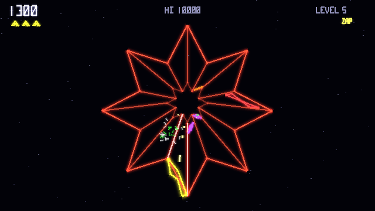

# Gyre for Vircon32

Version 1.0. A tube shooter in the style of Tempest for the Vircon32 fantasy console, drawn entirely with glowing vector lines by `vector.h`.

**Gyre.v32** is the ready-to-play cartridge. Load it in the Vircon32 emulator.



More screenshots are in `screenshots/`. See `CHANGELOG.md` for everything in this release.

## How to play

Your claw rides the rim of a wireframe tube. Enemies climb up the lanes from the far end. Shoot them before they reach the rim.

| Input | Action |
|---|---|
| D-pad | Move along the rim. The claw moves to the neighbouring lane that lies most in the pressed direction, so on round webs Down always moves visually down. |
| B or A | Fire (hold for auto-fire) |
| X | Superzapper: destroys everything in the tube. Once per level, plus a weaker second use that destroys one enemy. |
| Start | Start / pause menu |
| Y (title screen) | Options |

**Enemies**

- **Flipper** (red bow tie): climbs, flipping between lanes now and then, and sometimes fires. On the rim it flips toward you and grabs the claw.
- **Tanker** (purple diamond, from level 2): splits into two flippers when shot or when it reaches the rim.
- **Spiker** (green spiral, from level 3): climbs partway, leaving a spike in its lane, then retreats. Shoot spikes to shorten them.
- **Fuseball** (spinning multicolored burst, from level 4): travels along the lane edges, climbing in fits and starts and hopping sideways. It can only be shot while it's crossing the middle of a lane, and it's worth 250, 500 or 750 points, more the deeper it is. On the rim it rolls toward you and destroys the claw if it crosses through your lane. It rolls slowly enough there that holding fire always gets a shot at it first.
- **Pulsar** (orange zigzag, from level 5): climbs to a set depth, then flips toward you. Every few seconds its lane flickers as a warning, then the whole lane is electrified for a moment, destroying the claw if it's in that lane. Worth 200.

Levels 4 and 5 show a one-line note about the new enemy under the level banner.

**Levels.** When a level's last enemy is gone, the claw dives down the tube to the next web. A spike in your lane during the dive destroys you, so move to a clear lane or shoot the spike away first.

There are sixteen webs, one per level, then they repeat:

| Levels | Webs |
|---|---|
| 1–6 | Circle, square, plus, V, star, flat strip |
| 7–16 | Triangle, heart, W, peanut, U, diamond, battlement, lopsided egg, S-wave, and a C with a gap at the top |

Several are open (the claw can't go all the way round) or have lanes of uneven width. The web changes color every four levels.

The first six levels climb gently. After that, enemies speed up faster (up to a cap), up to ten can be in the tube at once instead of eight, fuseballs and pulsars become more common, and pulsars pulse more often.

**Perfect level bonus:** clear a level without losing a life and you score 500 × the level number.

## Secret stages

Four bonus stages are hidden behind secret warps. Doing something unusual on a level sends the dive to a secret stage instead of the next web. Afterwards the game carries on with the next level. Each stage can be found once per game.

| Stage | What happens |
|---|---|
| Spin Cycle | The web slowly turns, claw and all. Shoot the orbs, 100 each. |
| Gem Rush | Gems climb a flat strip in a trail. Catch them with the claw, 250 each. Firing is off. |
| Dark Web | The web is invisible apart from your own lane. Shoot the orbs, 150 each. |
| Swarm | Rapid fire against 48 orbs, 60 each. |

No lives are at risk on a secret stage. Every target counts toward the total, and hitting or catching all of them adds a 5,000 bonus. How to reach them is in **Spoilers** at the end.

The memory card remembers every secret stage you've ever found. The high score page shows them as `SECRETS 2 OF 4`, with found stages by name and the rest as `?????`. Finding one for the first time shows **NEW SECRET FOUND** on the stage card. It's saved when the game ends, even a game you quit. Resetting the high scores doesn't forget the secrets.

## Music

| Track | Where it plays |
|---|---|
| Title theme (D minor, half-time synthwave, 31 s loop) | Title pages, attract demo, initials entry, options from the title |
| In-game theme (A minor trance, 150 BPM, 51 s loop) | During play |
| Secret stage loop (F major, bouncy, 12.8 s loop) | Secret stages |
| Level clear fanfare (3.6 s) | Each level clear, and a perfect secret stage |
| Game over sting (7.5 s) | When a game ends without making the table; the title theme follows softly |

The in-game theme carries on from where it stopped after a fanfare or a secret stage, instead of starting again each level. `chipmusic.h` gained `music_play_at`, `music_position` and `music_current` for that.

Extra life every 20,000 points.

**Watch for:**
- **Red flashing claw:** when a flipper or fuseball on the rim is right next to you and about to strike, the claw flashes red and trembles, with a low warning ping. Move or shoot.
- **Spikes crumble** with each hit and shatter when they're shot away completely.

## Pause menu

Start during play opens Resume, Options and Quit to Title. Quitting needs a second press of B, and a game you quit isn't scored. Options opened from here return to the pause menu with the game still frozen. Difficulty changes made mid-game apply from the next game.

## High scores and initials

The top five scores are kept with initials. On the entry screen, Up and Down change the letter, Left and Right move between letters, B moves to the next letter and Start finishes. Entry confirms by itself after 30 seconds. Scores set on Easy show a green **E** in the table, and Hard scores a red **H**.

## Options

| Option | What it does |
|---|---|
| Music volume / Effects volume | 0–10, takes effect immediately |
| Difficulty | Easy, Normal or Hard (below) |
| Screen shake | On or off |
| Screen flashes | On or off. Also turns off the superzapper's screen pulse |
| Reset high scores | Press B twice. Restores the default table and the built-in demo |

| | Easy | Normal | Hard |
|---|---|---|---|
| Lives | 5 | 3 | 2 |
| Enemy speed | ×0.8 | ×1 | ×1.2 |
| Time between spawns | ×1.3 | ×1 | ×0.8 |
| Flipper shots | Fewer | Standard | More |
| Flippers on the rim | Slower to flip | Standard | Quicker |
| Fuseballs on the rim | Pause longer between rolls | Standard | Pause less |
| Pulsars | Pulse less often, longer warning | Standard | Pulse more often, shorter warning |
| Enemy shot speed | ×0.85 | ×1 | ×1.15 |

## Attract mode

With nobody playing, the title cycles: logo (8 s), high score table (6 s), then a demo replaying a recorded game silently over the title theme, for up to 45 s. Start begins a game at any point.

The demo is a real replay: each game records its inputs (the first 60 seconds) and uses its own seeded random numbers, so replaying the seed and inputs reproduces the game exactly. A finished game becomes the new demo if it beats the current demo's score and lasted at least 10 seconds. Until then the built-in demo in `demo_builtin.h` plays. It starts on level 5, so attract mode shows the star web, fuseballs and pulsars. A demo remembers the level its game started on, and your own games always start on level 1.

## Memory card

Insert a card and Gyre saves the table, the demo, the options and the secrets you've found. Cards saved by development versions 0.5 to 0.7 (formats 4 and 5) load completely. Cards from earlier ones (formats 1 to 3) keep their table and options, but their demo is dropped, because it was recorded under older rules and might not replay correctly. A blank card is claimed with the signature `GYRE TUBE SHOOTER V1`; a card belonging to another game is never written to. Each part has its own checksum, and damaged parts are ignored. The layout is the same as Rockfield's (format version 6 here):

| Words | Contents |
|---|---|
| 0–19 | Signature |
| 20 | Format version |
| 21–25 / 26–30 | Scores / initials (difficulty in the top byte) |
| 31–33 | Demo seed, length, score |
| 34 / 35 | Checksums of the table and the demo |
| 36 / 37 / 38 | Options, checksum of 36, 38 and 39, demo difficulty plus its starting level × 256 |
| 39 | Secret stages ever found (one bit each) |
| 40–759 | Demo recording |

## What's here

- `Gyre.c`: the game.
- `LICENSE`: MIT license.
- `CHANGELOG.md`: what's in this release.
- `screenshots/`: title, gameplay on two webs, a secret stage, high scores, options and the pause menu.
- `vector.h`: the vector library, version 1.1, which adds a 3D camera:
  - `vec_camera` and `vec_project`;
  - `vec_line_3d`, with clipping at the near plane and the screen edges;
  - `vec_depth_fade`.
- `chipmusic.h`, `music_data.h`: the music engine from Rockfield (with resume added), and Gyre's five tracks as note events, about 17 KB.
- `make_sounds.py`, `make_music.py`: generate the sound effects, the music instruments and `music_data.h`.
- `Gyre.xml`, `vector_lines.png`: ROM definition and line texture.
- `demo_builtin.h`: the built-in attract demo, generated by `tools/gen_demo.py`.
- `tools/headless.cpp`: the headless test runner (scripted input, frame and audio capture, memory cards, dropped-frame log). Build it as described in Rockfield's README, from the official emulator's `DesktopEmulator` folder: `g++ -O2 -std=c++14 -I. path/to/headless.cpp ConsoleLogic/*.cpp -o headless`.
- `tools/gen_demo.py`: plays scripted games with the headless runner and turns the best recording into `demo_builtin.h`. Run it on a build without a built-in demo; that build may start games on a later level, and the demo remembers it.

## Building

With the Vircon32 dev tools on your PATH, and Python 3 with NumPy:

```
python3 make_sounds.py
png2vircon vector_lines.png -o vector_lines.vtex
mkdir -p obj
compile Gyre.c -o obj/Gyre.asm
assemble obj/Gyre.asm -o obj/Gyre.vbin
packrom Gyre.xml -o Gyre.v32
```

`make_sounds.py` also regenerates `music_data.h`. The result is identical to the included `Gyre.v32`.

The order of the sounds in `Gyre.xml` must match the `SND_` numbers in `Gyre.c`, which is the order of the `SOUNDS` list in `make_sounds.py`.

## Keeping replays exact

- Game logic reads input only through the input layer (`in_bits`, `in_held`), never the gamepad.
- Game logic uses only `grand()` / `frand()`. Anything visual (particles, shake, sound pitch) uses `fx_range()`, because drawing also runs while paused.
- `begin_game()` resets every piece of gameplay state.
- After changing a gameplay rule, regenerate `demo_builtin.h` and bump the card format version.

## Spoilers: the secret warps

| Stage | How to get there |
|---|---|
| Spin Cycle | Clear a level without moving the claw. |
| Gem Rush | During the dive, shoot away a spike in your lane before you reach it. |
| Dark Web | Finish a level with the second, weaker superzapper: it must destroy the level's last enemy. |
| Swarm | From level 5 on, clear a level without losing a life and without using the superzapper. |

If one level qualifies for more than one, the first stage in this table that you haven't found yet is used.
